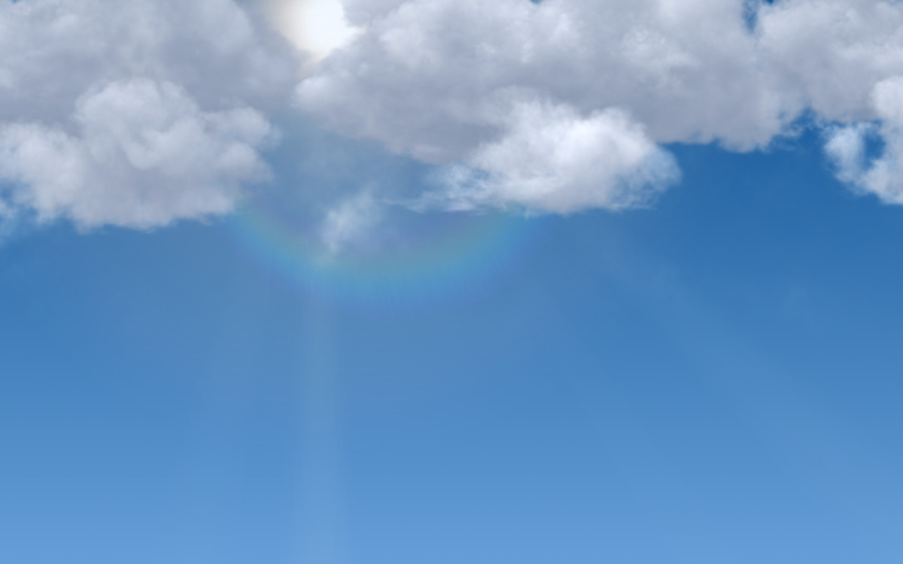
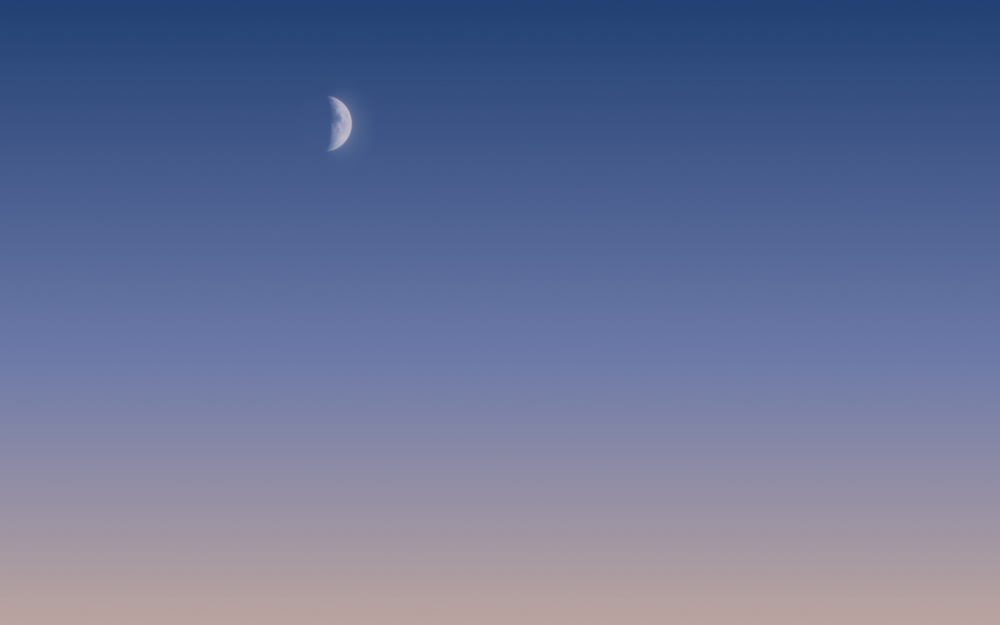
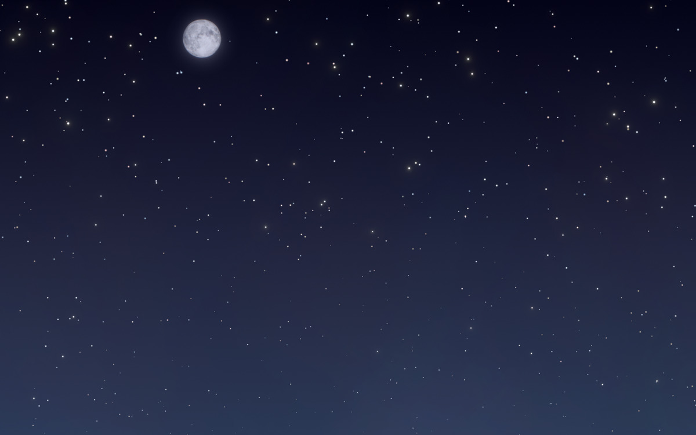
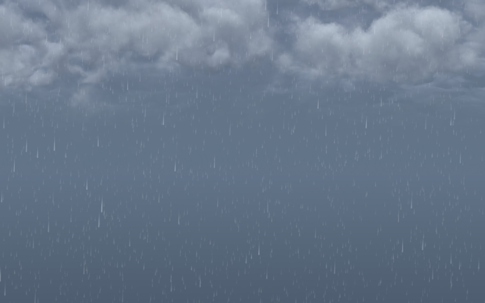

# LiveSky

[English](README.md)

**把 Mac 的壁纸变成一扇窗。**

LiveSky 让你的壁纸和所在地的真实天空同步。清晨还是黄昏，晴天还是下雨，满月还是月牙——窗外的天空是什么样，你的桌面就是什么样。

<p align="center">
  
  
  
  
</p>

这些画面不是照片，也不是仿制品，而是 macOS 自带的天气渲染引擎画的，和“天气”App 用的是同一套。LiveSky 常驻菜单栏，在后台安静地更新，每块显示器、每个桌面空间都会同步。

## 安装

1. 从 [Releases](https://github.com/SkyJinXX/LiveSky/releases) 下载 `LiveSky.zip` 并解压。
2. 把 `LiveSky.app` 拖进“应用程序”文件夹。直接在“下载”文件夹里打开是无法运行的。
3. 打开 LiveSky。因为 LiveSky 没有 Apple 开发者 ID 签名，macOS 会提示无法验证这个 App，点“完成”。
4. 打开 **系统设置 → 隐私与安全性**，往下滚动，点 LiveSky 旁边的 **仍要打开**，再确认一次。

之后在欢迎窗口里选好位置，窗外的天空就会出现在你的桌面上。

## 动态天空

天空也会动，和“天气”App 里一样：雨在下，雪在飘，云在走，星星在闪。LiveSky 把苹果的动画放在桌面图标后面、壁纸上面的一个窗口里播放，壁纸本身照常更新。

- 菜单里的 **动态天空** 可以一键开关动画。
- 下面两项分别设置插电和用电池时的帧率上限：静止、12、24、30 或 60 帧（默认插电 60、电池 12）。实际帧率由天气决定：晴天 24 帧，多云和雾 30 帧，雨、雪、雷暴 60 帧。低电量模式按“用电池时”的设置。
- 桌面大部分被窗口挡住、锁屏、Mac 温度较高时，动画会自动暂停，所以大部分时间它不耗电。动起来时，耗电和开着“天气”App 差不多：在 M3 Pro 的 MacBook Pro 上只有零点几瓦。
- 为了判断桌面有没有被挡住，LiveSky 会读取屏幕上窗口的位置和大小，不读标题和内容，也不需要任何权限。
- 锁屏界面显示的是静态壁纸。在“活动监视器”里，动画显示为 LiveSky Renderer，每块显示器一个。

## 兼容性

需要搭载 Apple 芯片的 Mac。

| 系统 | 状态 |
| --- | --- |
| macOS 15 Sequoia | ✅ 可用（真机测试：MacBook Pro M3 Pro，macOS 15.7.7） |
| macOS 26 Tahoe | ⚠️ 只在虚拟机里测试过（26.6.2） |
| macOS 27 | ⚠️ 只在虚拟机里测试过（27.0.1） |

在虚拟机里所有检查都能通过，天空颜色也和 macOS 15 一致，但虚拟机画不出太阳、月亮和云。如果你的真机装的是 macOS 26 或 27，欢迎[提个 Issue](https://github.com/SkyJinXX/LiveSky/issues) 说说效果。

LiveSky 依赖苹果的私有框架，其他系统版本或以后的系统更新可能会让它失效。遇到这种情况，它不会动你的壁纸，只会在菜单里提示；提 Issue 时请附上菜单里 **导出诊断信息…** 生成的报告。

## 从源码构建

需要安装 Xcode。

```bash
git clone https://github.com/SkyJinXX/LiveSky.git
cd LiveSky
./build.sh
```

生成的 App 在 `build/LiveSky.app`。

## 许可证

[MIT](LICENSE)。天空由你 Mac 上苹果的 WeatherUI 框架绘制，LiveSky 不包含任何苹果的代码或美术素材。天气数据来自 [Open-Meteo.com](https://open-meteo.com)（[CC BY 4.0](https://creativecommons.org/licenses/by/4.0/)）。

---

如果你也喜欢桌面上的这扇窗，欢迎点个 ⭐ Star，让更多人看到它。
